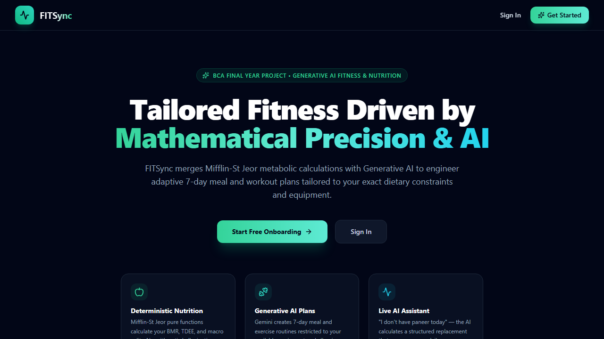
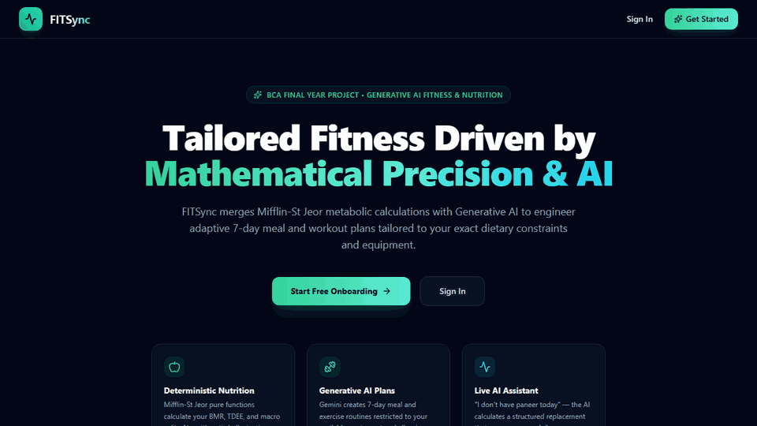

# FITSync 🏋️‍♂️🥗

> **Generative AI-Powered Personalized Workout & Nutrition Planner**  
> *BCA Final Year Project*

FITSync bridges metabolic science with Generative AI. It deterministically calculates personal metabolic targets (BMR, TDEE, macronutrient splits) via the **Mifflin-St Jeor formula** in pure code, while delegating dynamic meal curation, exercise selection, and smart conversational ingredient substitutions to AI under strict **Zod** schema validation.

---

## 📸 Preview & Live Walkthrough





> 🎬 **[Watch Full Demo Video (WebM)](./docs/demo.webm)**

---

## 🛠️ Tech Stack

- **Frontend:** React (Vite), Tailwind CSS, React Router, Axios, Recharts, Lucide Icons
- **Backend:** Node.js, Express (ES modules), REST API
- **Database:** MongoDB with Mongoose
- **AI Service:** Google Gemini API (isolated in `services/ai.service.js` for modular swapping)
- **Validation & Auth:** Zod, JWT stored in `httpOnly` secure cookies, bcryptjs password hashing
- **Testing:** Jest for the deterministic nutrition engine

---

## 📁 Repository Structure

```
fitsync/
├── client/                      # React (Vite) + Tailwind CSS + Lucide
│   └── src/
│       ├── api/                 # Preconfigured Axios instance with credentials
│       ├── components/          # Navbar, MealCard, WorkoutCard, ChatBox, etc.
│       ├── context/             # AuthContext
│       ├── pages/               # Login, Register, Onboarding, Dashboard, etc.
│       ├── hooks/
│       ├── App.jsx              # Router & layout
│       └── main.jsx
├── server/
│   ├── src/
│   │   ├── config/              # db.js, env.js
│   │   ├── models/              # User, Profile, Plan, ProgressLog, ChatMessage
│   │   ├── routes/              # auth, profile, plan, progress, chat, health
│   │   ├── controllers/         # Request handling logic
│   │   ├── services/
│   │   │   ├── nutrition.service.js   # BMR, TDEE, macros (pure functions)
│   │   │   ├── ai.service.js          # Gemini/OpenAI provider wrapper
│   │   │   ├── plan.service.js        # Prompt orchestration & validation
│   │   │   └── chat.service.js        # Substitution & patch logic
│   │   ├── prompts/             # Modular prompt templates
│   │   ├── validators/          # Zod schemas (AI responses & request payloads)
│   │   ├── middleware/          # auth, errorHandler, rateLimit
│   │   ├── utils/
│   │   ├── app.js               # Express app configuration & middleware
│   │   └── server.js            # Entry point & DB connection
│   ├── tests/                   # Jest unit tests for nutrition calculations
│   └── .env.example
├── BUILD_GUIDE.md               # Master specifications and implementation phases
├── GEMINI.md                    # IDE master context prompt and non-negotiable rules
├── package.json                 # Monorepo workspace orchestration
└── README.md
```

---

## 🚀 Quickstart Guide

### 1. Prerequisites
- Node.js (v18+)
- MongoDB running locally on `localhost:27017` or a MongoDB Atlas URI

### 2. Environment Variables
Copy `.env.example` in `server/` to `server/.env`:
```bash
cp server/.env.example server/.env
```
Ensure your `GEMINI_API_KEY` and `MONGO_URI` are set.

### 3. Install Dependencies
Install all root, client, and server dependencies with:
```bash
npm run install:all
```

### 4. Run Development Servers
To run both backend API and frontend concurrently:
```bash
npm run dev
```

Or run them individually:
```bash
npm run dev:server   # Backend API on http://localhost:5000
npm run dev:client   # Frontend on http://localhost:5173
```

### 5. Verify Setup
- **Health Check API:** `GET http://localhost:5000/api/health`
- **Frontend App:** Visit `http://localhost:5173`
